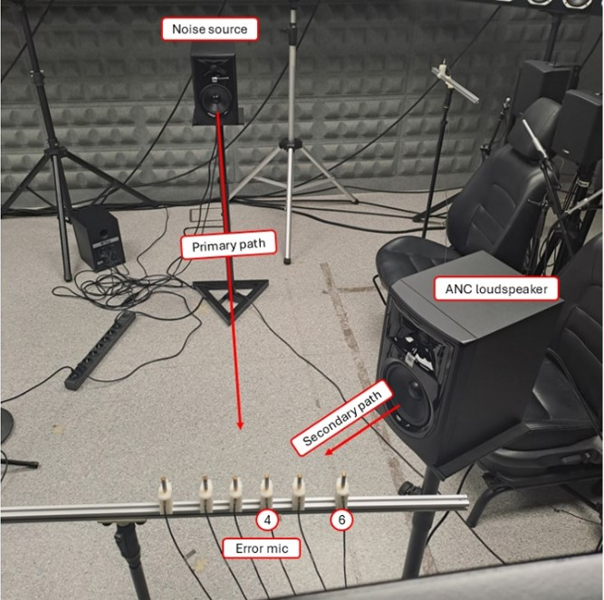
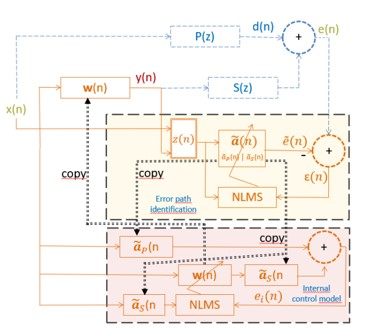

# PIME-FxNLMS

## Table of contents
- [PIME-FxNLMS](#pime-fxnlms)
  - [Table of contents](#table-of-contents)
  - [Introduction](#introduction)
  - [Repository Contents](#repository-contents)
  - [Demo](#demo)
  - [PIME-FxNLMS Algorithm](#pime-fxnlms-algorithm)
  - [Run explanation](#run-explanation)
    - [Matlab model](#matlab-model)
    - [Simulink model](#simulink-model)

## Introduction
In this project, the proposed PIME-FxNLMS (Parallel Internal Model and Error path estimation Filtered-x Normalized LMS) algorithm is implemented in Simulink and deployed on a real-time Speedgoat target to cancel broadband noise using a feedforward ANC configuration. This algorithm estimates both the primary and secondary acoustic paths online. This makes the algorithm robust to changes in the environment while running, such as moving the error microphone to a different position.

This repository provides three ways to run the algorithm: a MATLAB script implementation, a Simulink simulation model, and a Simulink model for real-time execution on a Speedgoat target.

Paper published in [IEEE Xplore](https://ieeexplore.ieee.org/document/11716690).

## Repository Contents
````text
PIME-FxNLMS/
├── README.md
├── matlab code/
│   ├── main.m
│   ├── pime_fxnlms_online_estimation.m
│   ├── acoustic_paths_gen.m
│   ├── rir_generator.mexw64
│   └── rir_generator.mexmaci64
├── simulink models/
│   ├── PIME_FxNLMS_2023a.slx
│   ├── PIME_FxNLMS_Speedgoat_2023a.slx
│   ├── pime_init.m
│   └── paths_mic643.mat
└── Images/
    ├── setup.jpg
    └── pime_model.jpg
````

## Demo
The real-time implementation runs on a Speedgoat target, with the acoustic setup shown below:

  
Figure 1: Physical real-time setup

- Real-time target: Speedgoat performance P3
- Conditioning amplifier: B&K Type 2694
- Error microphone: B&K Type 4958
- Noise source loudspeaker / ANC loudspeaker: JBL Professional 305P MkII

The following video shows the PIME-FxNLMS algorithm working in real time on Speedgoat, with the reference noise playing continuously and the error microphone position being changed mid-run to demonstrate online re-estimation of the acoustic paths. The audio playing in the video is what the error microphone captured.

[PIME-FxNLMS algorithm video demo](https://gtac-iteam-upv.github.io/ANC_demo/)

## PIME-FxNLMS Algorithm

  
Figure 2: Proposed ANC system with online error path identification and internal control model

The proposed algorithm PIME-FxNLMS runs two adaptive systems in parallel:

- Error path identification: An NLMS filter estimates both P(z) and S(z) from the reference signal x(n), y(n) and the error microphone signal e(n).
- Internal control model: A second FxNLMS filter uses the current estimate of S(z) as if it were the true one to adapt the control filter, avoiding the divergence and oscillations that arise when an inaccurate secondary path estimate is used directly in the control loop.

The real error e(n) and the internal model error ei(n) are blended with a soft-decision weight γ(n), based on how well the internal model has converged, to form the error signal used to update the control filter, relying more on ei(n) while identification is still converging, and more on e(n) once it is reliable, further reducing the cancellation error.  

Note: individual estimates of P(z) and S(z) are not guaranteed to converge to the true acoustic paths, but the internal control model has been shown to converge to the optimal noise-canceling filter Wopt(z) = -P(z)/S(z).

## Run explanation
### Matlab model

The PIME-FxNLMS implemented in MATLAB code uses three files:    
- #### acoustic_paths_gen.m
  
  Generates the primary and secondary path impulse responses using the **rir_generator** MEX file (precompiled for Windows and macOS Intel). Here, the room size, microphone and speaker positions can be adjusted.
  
- #### pime_fxnlms_online_estimation.m
  
   Implements the PIME-FxNLMS algorithm. On each sample it estimates the primary and secondary paths online, updates the internal control model in parallel, blends its error with the real error using the weight γ(n), and updates the control filter. It also supports switching between two sets of real acoustic paths mid-simulation, to reproduce the path-change experiments from the paper.

- #### main.m
  
   Defines the algorithm parameters, calls acoustic_paths_gen.m to generate the acoustic paths, runs pime_fxnlms_online_estimation.m, and plots the resulting signals and curves. This is the only file that needs to be run.  
  
### Simulink model 

- #### PIME_FxNLMS_2023a.slx  
  
  This model simulates the algorithm in Simulink. To configure the parameters edit and run **pime_init.m**. The **paths_mic643.mat** loaded in the initialization file are real impulse responses recorded for the primary and secondary paths from three different microphone positions, these can be replaced with other paths.

- #### PIME_FxNLMS_Speedgoat_2023a.slx
  
  This is the model used in the demo to run the algorithm in real time on a Speedgoat. To configure the parameters edit and run **pime_init.m**.

  
  

